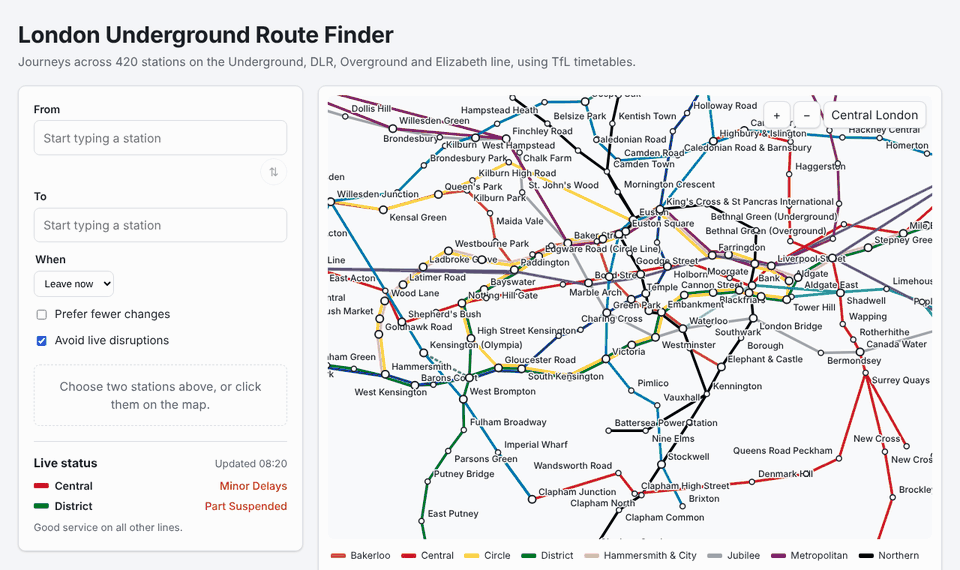
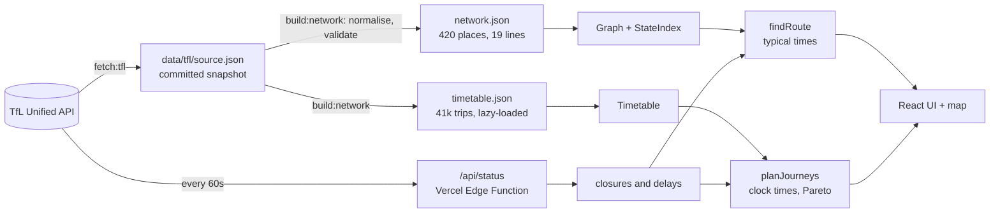

# London Underground Route Finder

[](https://github.com/AbdulRafeyMubasshir/tube_route_finder/actions/workflows/ci.yml)
[](https://tube-route-finder.vercel.app)

A journey planner for London's rail network: the Underground, DLR, Overground
and Elizabeth line. It plans journeys on **real TfL timetables** with
**RAPTOR**, the algorithm behind production journey planners. It routes around
**live disruptions**, and it **works offline**.



**Try it:**
[Brixton → Stanmore](https://tube-route-finder.vercel.app/?from=brixton&to=stanmore) ·
[Heathrow T5 → Canary Wharf](https://tube-route-finder.vercel.app/?from=heathrow-airport-terminal-5&to=canary-wharf) ·
[Arrive at Bank by 09:00](https://tube-route-finder.vercel.app/?from=wimbledon&to=bank&at=09:00&day=mon&by=arrive)

📖 **[How it works: building a London journey planner with RAPTOR](docs/how-it-works.md)**

## Highlights

|                      |                                                                                                                                                           |
| -------------------- | --------------------------------------------------------------------------------------------------------------------------------------------------------- |
| **Routing**          | RAPTOR over about 25,000 TfL departures: clock times, Pareto-optimal options (faster with more changes vs simpler), leave now, leave at, or **arrive by** |
| **Correctness**      | Service patterns, not lines (no impossible Northern-line branch hops); multi-station interchanges with walking links; service days past midnight          |
| **Live**             | Vercel Edge Function proxies and caches TfL status; both engines avoid closures and allow for delays, and explain what they did                           |
| **Performance**      | About 0.34 ms per journey (p50) for a full Pareto set; the integer-indexed Dijkstra went from about 2 ms to 0.4 ms                                        |
| **Testing**          | 143 tests including **property-based tests** against naive reference solvers, which found three real RAPTOR bugs; coverage and a benchmark run in CI      |
| **Data engineering** | Reproducible TfL snapshot → validated build-time compilation (it caught zero-minute hops); weekly automated refresh PRs                                   |
| **Frontend**         | Geographic map with shared track drawn side by side and collision-free labels; accessible station search; offline-first PWA; shareable URLs               |

## Architecture



- **`src/engine/`**: a framework-free routing engine.
  - `planJourneys` (RAPTOR) answers "when will I get there?".
  - `findRoute` (Dijkstra over a station/train state graph) answers "how long
    does it usually take?". It's instant and needs no timetable, and is the
    fallback.
- **`scripts/`**: the TfL fetcher and compilers. They're pure functions,
  unit-tested against a fake API.
- **`api/status.ts`**: an edge function that fetches TfL line status with the
  API key on the server and a 60-second edge cache.
- **`src/`**: the React UI, map, service-day and arrive-by logic, and label
  placement.

Each design decision has a short record in [`docs/adr/`](docs/adr), and the
[write-up](docs/how-it-works.md) tells the whole story.

## Testing

| Layer    | What is tested                                                                                                                                                    |
| -------- | ----------------------------------------------------------------------------------------------------------------------------------------------------------------- |
| RAPTOR   | Waiting, last trains, change times, Pareto options, walks, boarding earlier trips; **property test** against a time-dependent Dijkstra on 1,000 random timetables |
| Dijkstra | Branch changes, shared sections, walking, multi-station origins, penalties; **property test** against Bellman-Ford on random networks                             |
| Live     | Status parsing from a real TfL response, the edge function (cache headers, upstream failure), closures and delays in both engines, rerouting in the UI            |
| Pipeline | Fetch logic against a fake TfL API; network and timetable compilation, estimates, validation errors                                                               |
| Data     | Connectivity of the real network; golden journeys (Brixton→Stanmore, Morden→High Barnet, Heathrow T5→Canary Wharf…)                                               |
| UI & map | Station search and keyboard navigation, leave/arrive controls, journey options, offline notice; label placement never overlaps (property test)                    |

CI runs on every push: data freshness check, lint, formatting, strict
type-check, tests with coverage thresholds (90% lines, 85% branches), build,
and benchmark.

## Performance

`npm run bench` times 20,000 fixed pseudo-random weekday journeys on the full
network (420 places, 3,539 search states, 243 timetable routes):

| Router                              | p50     | p95     | p99     |
| ----------------------------------- | ------- | ------- | ------- |
| RAPTOR, timetabled, full Pareto set | ~340 µs | ~510 µs | ~650 µs |
| Dijkstra, typical times             | ~400 µs | ~750 µs | ~950 µs |
| Dijkstra, fewer changes             | ~370 µs | ~740 µs | ~910 µs |

Measured on Node 22 in a CI-class Linux container. Numbers vary by machine.

## Getting started

```bash
npm install
npm run dev            # start the dev server
npm test               # run tests
npm run ci             # everything CI runs
npm run bench          # routing benchmark
npm run fetch:tfl      # refresh data/tfl/source.json from the TfL API (optional TFL_APP_KEY)
npm run build:network  # recompile network.json and timetable.json
```

Requires Node 20 or later. Live status works in development too: the app falls
back to calling TfL directly when `/api/status` isn't available.

## Project structure

```
api/status.ts      edge function: cached, trimmed TfL line status
src/
  engine/          raptor (Timetable, planJourneys), Graph, StateIndex, findRoute, conditions, MinHeap
  components/      StationCombobox, DepartureControl, JourneyOptions, RouteDetails, StatusPanel, TubeMap
  lib/             service days and arrive-by, journey choice, label placement, map geometry, URL state
  data/            generated network.json and timetable.json
scripts/
  tfl/             fetcher and compilers (pure, unit-tested)
  fetch-tfl.ts, build-network.ts, benchmark.ts
data/tfl/          committed TfL snapshot
docs/              write-up, ADRs, media
```

## Limitations

- **Estimated times on some lines.** TfL publishes no timetables for the
  Elizabeth line and Overground, so their run times are estimated from distance
  and their trips from an assumed frequency. These are marked "est." in the app.
- **Some trains are missing.** Trains that start mid-line (e.g. from depots)
  aren't included, as timetables are fetched from termini.
- **Delays are approximate.** They're modelled as slower run times, since TfL
  doesn't publish expected delay minutes.
- **No step-free routing.** TfL's API accessibility data is too incomplete to
  route on safely (see [ADR 0006](docs/adr/0006-live-status-and-disruption-routing.md)).

## Tech

TypeScript 5 (strict) · React 19 · Vite · d3-zoom · Workbox (PWA) · Vitest ·
Testing Library · fast-check · ESLint · Prettier · GitHub Actions · Vercel (Edge
Functions)

## Credits

Data: Powered by TfL Open Data. Contains OS data © Crown copyright and database
rights. Not affiliated with or endorsed by Transport for London.

Algorithm: D. Delling, T. Pajor, R. F. Werneck, _Round-Based Public Transit
Routing_, ALENEX 2012.

Built by [Abdul Rafey Mubasshir Mohammed](https://github.com/AbdulRafeyMubasshir).
