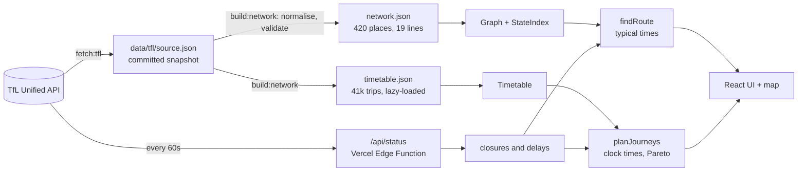

# Building a London journey planner with RAPTOR

_How the London Underground Route Finder turns TfL's open data into timetabled,
multi-option journeys in under a millisecond, entirely in the browser._

**Live demo:** https://tube-route-finder.vercel.app ·
**Code:** https://github.com/AbdulRafeyMubasshir/tube_route_finder

---

## The problem

"How do I get from Wimbledon to Canary Wharf?" sounds like a shortest-path
question. It stops looking like one once you use real data:

- **Lines branch.** The Northern line has eight stopping patterns. A planner
  that treats "the Northern line" as one track will happily route you from the
  Charing Cross branch onto the Bank branch with no change, which no train does.
- **Time matters.** The best journey at 08:20 isn't the best at 23:50, and after
  the last train there isn't one at all.
- **There's rarely one right answer.** Some people want the faster option with
  two changes, others the direct train that's four minutes slower.
- **The network changes under you.** On a typical weekend several lines are
  part-closed and others are delayed.

This project started as a university-style Dijkstra demo over 90 hand-placed
stations. This is how it became a timetable-aware planner over the whole
network.

## Architecture

Everything runs client-side except one small edge function. The routing
engine is plain TypeScript with no framework dependencies, and the data is
compiled at build time.

## 1. Data: from API responses to a validated network

TfL publishes each line as **ordered line routes** (stopping patterns), and
for Underground and DLR lines, **timetables** listing every departure from each
terminus with cumulative run times.

The pipeline is split into two steps:

1. `npm run fetch:tfl` downloads the data (about 90 requests, paced for
   anonymous rate limits) into a compact snapshot that is **committed**, so
   builds are reproducible and don't depend on TfL being up. A weekly GitHub
   Action refreshes it and opens a pull request.
2. `npm run build:network` compiles the snapshot, and fails the build when the
   data is wrong. It checks for unknown stops, non-positive run times, outliers
   against a distance-based estimate, and that every place can reach and be
   reached from every other. On the very first run it caught four hops with a
   travel time of zero minutes.

Two modelling choices matter a lot:

- **Places, not platforms.** "Bank" is a TfL hub containing Bank Underground
  and Bank DLR. You search for places. The engine starts from every station in
  the origin place and stops at any station in the destination, with walking
  links between stations in a place and between stations under 350 m apart
  (e.g. Bank ↔ Monument).
- **Patterns, not lines.** Ride edges are expanded per stopping pattern, so the
  engine knows which train you're on.

TfL doesn't publish timetables for the Elizabeth line and Overground (the
endpoint returns 404). Their run times are estimated from distance and typical
speed, their trips from an assumed frequency, and both are labelled "est." in
the UI. Being explicit about that is better than quietly presenting guesses as
timetables.

## 2. Dijkstra, done carefully

The first engine answers "how long does this usually take?" from average run
times. It runs Dijkstra over a **state graph** rather than the station graph:

- _at a station_, either not yet boarded or on the platform after a train
- _on a train_: at position _j_ of pattern _p_

From a train you can stay on (free) or alight. From a station you can board
any departing train or walk. Boarding after you've already travelled is a
change, which costs a change allowance plus an optional penalty for "prefer
fewer changes". This makes branch-switching on the Northern line correctly a
change.

The first version keyed states by strings in `Map`s and took **about 2 ms** per
query on the full network. Two changes brought it to **about 0.4 ms** with
identical results:

1. Splitting "at a station" from "on a train" removed a quadratic blow-up at
   busy interchanges. Before, every state at a station tried every departure.
2. Compiling states into integers and transitions into flat arrays
   (compressed sparse row) let the search run on `Float64Array` and
   `Int32Array`.

## 3. RAPTOR: timetables and trade-offs

Dijkstra over average times can't say when you'll arrive, and it gives one
answer. For that I implemented **RAPTOR** (Round-bAsed Public Transit
Optimized Router; Delling, Pajor and Werneck, Microsoft Research, 2012), the
family of algorithms behind production journey planners.

The idea is simple:

- **Round _k_** computes the earliest arrival at every station using **at most
  _k_ trains**.
- In each round, every route touched in the previous round is scanned once, in
  stop order. At each stop you either alight from the trip you're on (if that
  improves the arrival) or board the earliest trip you can still catch, found
  by binary search over that route's sorted departures, with a minimum change
  time.
- Walking links are relaxed after each round.

Because rounds count trains, you get the **Pareto set** for free: each round
that improves the arrival at the destination is a journey where an extra train
buys a strictly earlier arrival. The UI shows these as options, for example
"08:35 → 09:28 · 3 changes" vs "08:35 → 09:40 · 2 changes", and "prefer fewer
changes" picks the simplest one within ten minutes of the fastest.

Data size matters in a browser. About 25,000 timetabled departures (plus
synthesised ones for untimetabled lines) are grouped into 243 routes, split by
day type and delta-encoded: **213 kB, 21 kB gzipped**, as a lazily loaded chunk.
The page is usable immediately with Dijkstra's typical times, and switches to
clock times when the timetable arrives.

Service days run past midnight, so before 04:00 the planner also searches the
previous day's late trains. After the last train, it plans the first journey
of the next morning and says so.

**Arrive-by** uses forward RAPTOR with binary search over departure time.
Earliest arrival never decreases as departure gets later (trains on a route
don't overtake each other), so the latest departure for each number of trains
takes about 8 queries. That's simpler and better tested than writing a second,
reverse engine.

### Performance

From `npm run bench`, 20,000 fixed pseudo-random weekday journeys on the full
network, Node 22:

| Router                              | p50     | p95     | p99     |
| ----------------------------------- | ------- | ------- | ------- |
| RAPTOR, timetabled, full Pareto set | ~340 µs | ~510 µs | ~650 µs |
| Dijkstra, typical times             | ~400 µs | ~750 µs | ~950 µs |

RAPTOR is faster than Dijkstra here _and_ returns more: a whole Pareto set with
clock times.

## 4. Testing a router you can't eyeball

Hand-written tests cover the obvious cases (waiting for the next train, the
last train, change times, branch changes, walking). But route-finding bugs
hide in combinations no one thinks to write down. So both engines are tested
with **property-based tests** ([fast-check](https://fast-check.dev)) against
deliberately naive reference implementations:

- **Dijkstra** is compared with Bellman-Ford over the same states on hundreds
  of random networks: the optimal cost must match, and every route must be a
  connected path of real edges.
- **RAPTOR** is compared with a plain time-dependent Dijkstra over trips on
  1,000 random timetables. The earliest arrival must match, each extra train
  must buy a strictly earlier arrival, and every journey's clock times must be
  consistent.

This paid off. Raising RAPTOR's property test to 1,000 runs found **three real
bugs**, all in how walking combines with trains:

1. A train arriving at the same time as a walk was discarded, although
   arriving by train lets you walk on and arriving on foot doesn't.
2. A walk could chain through a stop that another walk had just improved in
   the same round.
3. A journey could be rebuilt from a walk-improved arrival rather than the
   train arrival its final walk actually started from, which made the
   displayed times wrong.

The fix in each case was to keep train and walk labels separately, as the
RAPTOR paper does. Each failure was shrunk by fast-check to a three-station
counterexample, which is now a regression test.

The rest of the suite covers the data pipeline (against a fake TfL API), golden
journeys on the real network, label placement (labels must never overlap),
the edge function, and the UI with Testing Library. That's 143 tests, run on
every push with lint, type-check, coverage thresholds and the benchmark.

## 5. Live disruptions

A Vercel Edge Function at `/api/status` proxies TfL's line status feed. It
keeps the API key on the server, trims the response, and caches it at the edge
for 60 seconds, so all visitors share one upstream request a minute. Statuses
become **conditions**: closed hops for closures, and a run-time multiplier for
delays (1.15× minor, 1.35× severe). Both engines apply them. RAPTOR drops a
trip at a closed hop and stretches delayed routes uniformly, which keeps trips
in order. The UI explains what it did: "Rerouted to avoid: District
(Part Suspended)".

Step-free routing was planned and deliberately **not shipped**. TfL's API
accessibility data covers about a third of stations, and some values contradict
TfL's own step-free guide. Routing people who depend on step-free access with
data like that would be worse than not offering it.

## 6. A map you can read

The map is geographic (projected from TfL coordinates), drawn as SVG with
`d3-zoom`. Two details make it readable:

- **Shared track drawn side by side.** Lines sharing a section get a
  perpendicular offset in screen pixels, applied as a CSS transform scaled by
  a zoom-dependent variable, so they stay 4 px apart at every zoom with no
  re-render.
- **Labels that never overlap.** After each zoom frame, a greedy placer puts
  labels in priority order (your journey first, then busier interchanges),
  tries four positions around each station, and uses a spatial grid to keep it
  well under a millisecond for about 400 labels.

## 7. Works on the Underground

The app is a PWA. The app shell, the network and the timetable are precached
by a service worker (about 740 kB), so planning works with no signal. Live
status falls back to the last response, and the UI says you're offline.

## What I'd do next

- Real timetables for the Elizabeth line and Overground (e.g. from national
  rail GTFS), replacing the estimates.
- Trains starting mid-line (depot starts), which TfL's terminus timetables miss.
- Step-free routing once there's an authoritative data source.
- McRAPTOR-style extra criteria, such as walking distance or crowding.

## Design records

Each decision above has a short architecture decision record in
[`docs/adr/`](adr):

1. [Dijkstra over a (station, line) state graph](adr/0001-state-expanded-dijkstra.md)
2. [Vite, and network data compiled at build time](adr/0002-vite-and-build-time-data.md)
3. [TfL data, service patterns and places](adr/0003-tfl-data-patterns-and-places.md)
4. [Station/train state model and integer-indexed search](adr/0004-search-state-model-and-typed-arrays.md)
5. [RAPTOR over TfL timetables](adr/0005-raptor-with-tfl-timetables.md)
6. [Live line status and routing around disruption](adr/0006-live-status-and-disruption-routing.md)
7. [Readable map, arrive-by planning, and offline use](adr/0007-map-polish-arrive-by-and-offline.md)

---

_Data: Powered by TfL Open Data. Contains OS data © Crown copyright and
database rights. Not affiliated with or endorsed by Transport for London._
